<p align="center">
  <picture>
    <source media="(prefers-color-scheme: dark)" srcset=".github/assets/sniptide-readme-dark.svg">
    
  </picture>
</p>

[](https://github.com/Dino-Kupinic/sniptide-web/actions/workflows/ci.yml)
[](https://sniptide.com)
[](https://docs.sniptide.com)

# Sniptide website

This repository is the marketing site for [Sniptide](https://github.com/Dino-Kupinic/sniptide),
served at [sniptide.com](https://sniptide.com). It holds the landing page, the blog, the changelog,
templates, legal pages and the files that describe Sniptide to agents and search engines.

The site is a small Next.js 16 app that shares its components and theme with the app through the
[`@sniptide/ui`](https://www.npmjs.com/package/@sniptide/ui) package.
Self-hosted Sniptide instances don't need this repository, because the app works on its own.

## Run it locally

Install the dependencies with [Bun](https://bun.sh), point the sign-in and paste links at a local
app, and start the dev server on [localhost:3001](http://localhost:3001):

```bash
bun install
cp .env.example .env.local
bun dev
```

Run the same checks as CI before you push:

```bash
bunx biome ci .
bun run typecheck
bun run test
bun run build
```

## How it fits with the app

Coolify builds the `Dockerfile` from `main` and serves it at sniptide.com, while the app runs at
[app.sniptide.com](https://app.sniptide.com). Share links stay on sniptide.com because any path
without a page here is proxied to the app, and app pages such as `/sign-in` and `/dashboard`
redirect to the same path on app.sniptide.com.
The [deployment guide](docs/deployment.md) covers the proxy, environment variables, link previews,
IndexNow and the legal pages.

## Documentation

- [Development](docs/development.md), [contributing](CONTRIBUTING.md) and [pull requests](docs/pull-requests.md)
- [Deployment](docs/deployment.md)
- [Blog](docs/blog.md) and the [blog style guide](docs/blog-style-guide.md)
- [Changelog](docs/changelog.md) and [templates](docs/templates.md)
- [Agents and search engines](docs/agents.md) and [analytics](docs/analytics.md)
- [Landing page media](docs/landing.md) and [secret scanning](docs/secret-scanning.md)

The user guide for Sniptide itself lives at [docs.sniptide.com](https://docs.sniptide.com).

## License

This website repository is licensed under [AGPL-3.0-only](LICENSE). See the core repository's
[licensing guide](https://github.com/Dino-Kupinic/sniptide/blob/main/LICENSING.md) for the
open-source core and hosted services.
